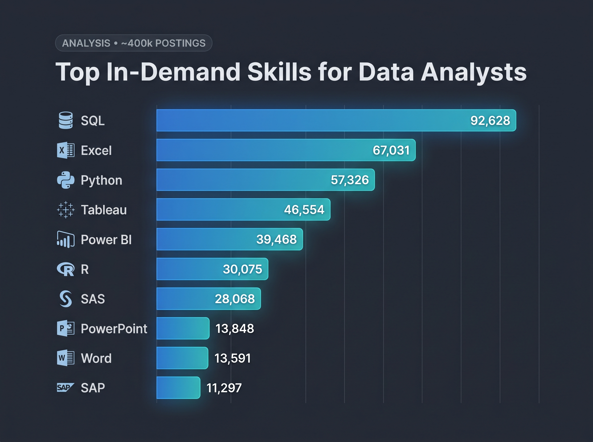

# SQL for Data Analytics

This repository showcases course content and final capstone project from the **SQL for Data Analytics** course by **Luke Barousse**. The course provides an end-to-end foundation in SQL and relational database analytics, using real-world tech job posting data to advance from core querying to production-grade PostgreSQL development

[](https://www.lukebarousse.com/)
[](https://www.postgresql.org/)
[](https://code.visualstudio.com/)

## Course Content


* **Relational DB Basics:** RDBMS concepts, star schemas, fact vs. dimension tables
* **Core Querying:** Retrieval, aliases, deduplication, and sorting (`SELECT`, `AS`, `DISTINCT`, `ORDER BY`, `LIMIT`)
* **Filtering:** Conditions, ranges, wildcards, and null handling (`WHERE`, `IN`, `BETWEEN`, `LIKE`, `IS NULL`)
* **Aggregation:** Summary statistics with grouping and filter conditions (`COUNT`, `SUM`, `AVG`, `GROUP BY`, `HAVING`)
* **Table Joins:** Relational linking via `INNER`, `LEFT`, `RIGHT`, and `OUTER JOIN`
* **Query Execution:** Internal DB execution logic (`FROM` → `WHERE` → `GROUP BY` → `SELECT`)
* **DDL & DML:** Schema creation, alteration, data manipulation, CSV loading (`CREATE`, `ALTER`, `INSERT`, `UPDATE`)
* **Subqueries & CTEs:** Complex query modularization via nested subqueries and `WITH` clauses
* **Logic & Set Operations:** Branching logic (`CASE WHEN`) and dataset merging (`UNION`, `UNION ALL`)
* **Dates & Tooling:** Temporal analysis (`EXTRACT`, time zones) in local PostgreSQL and VS Code environments


## Tools

| Tool  | Purpose |
| :--- | :--- |
| **PostgreSQL** | Relational database hosting real-world job posting datasets |
| **VS Code** | IDE with SQLTools integration for interactive query execution |
| **Git & GitHub** | Version control, documentation, and portfolio hosting |


## Capstone Project:

The course culminates in a capstone project focused on real-world labor market analytics. Using a normalized dataset of 2023 tech job postings, you analyze compensation patterns, market demand, and skill values to identify high-leverage career opportunities.

### Key Questions Addressed:

1. **Top-Paying Roles:** What are the highest-paying jobs available for the targeted role?
2. **Skills for Top Earners:** What specific technical skills are required for these top-paying positions?
3. **In-Demand Skills:** Which tools and technologies appear most frequently across all postings?
4. **Top Skills by Salary:** Which skills correlate with the highest average compensation?
5. **Optimal Skills:** Which high-value skills offer the ideal combination of high demand and premium pay?

### Queries & Visualizations

[SQL Querries check them out here in project [SQL Folder](/project_sql) or click oin the links below

1. [Top-Paying Roles:](/project_sql/1_top_paying_jobs.sql)
2. [Skills for Top Earners:](/project_sql/2_top_paying_jobs_skills.sql)
3. [In demand Skills:](/project_sql/3_top_demanded_skills.sql)
4. [Top Skills by Salary:](/project_sql/3_top_demanded_skills.sql)
5. [Optimal Skills:](/project_sql/5_optimal_skills.sql)

## Example Result for Question 3

#### SQL Query

```sql
SELECT
    skills_dim.skills,
    COUNT(skills_job_dim.skill_id) AS demand_count
FROM
    job_postings_fact
INNER JOIN skills_job_dim on job_postings_fact.job_id = skills_job_dim.job_id
INNER JOIN skills_dim on skills_job_dim.skill_id = skills_dim.skill_id
WHERE
    -- Filters job titles for 'Data Analyst' roles
    job_postings_fact.job_title_short = 'Data Analyst'
GROUP BY
    skills_dim.skills
ORDER BY
    demand_count DESC
LIMIT 10;
```

#### Result Table

An analysis of ~400k skill mentions reveals that hiring demand is heavily concentrated in foundational querying, spreadsheet modeling, and programmatic scripting.

| Rank | Skill | Job Postings | Share | Key Use Case |
| :---: | :--- | :---: | :---: | :--- |
| 1 | **SQL** | 92,628 | 23.2% | Database extraction, transforms, joins |
| 2 | **Excel** | 67,031 | 16.8% | Ad-hoc modeling, quick analysis |
| 3 | **Python** | 57,326 | 14.3% | Data wrangling (Pandas), scripting, automation |
| 4 | **Tableau** | 46,554 | 11.6% | Enterprise BI dashboards |
| 5 | **Power BI** | 39,468 | 9.9% | Microsoft ecosystem BI & DAX modeling |
| 6 | **R** | 30,075 | 7.5% | Statistical modeling & academic research |
| 7 | **SAS** | 28,068 | 7.0% | Legacy analytics (banking, healthcare) |
| 8 | **PowerPoint** | 13,848 | 3.5% | Stakeholder presentations & reporting |
| 9 | **Word** | 13,591 | 3.4% | Documentation & written briefs |
| 10 | **SAP** | 11,297 | 2.8% | Enterprise ERP & operational data |

#### Result Graph



Gemini generated thei graph from my SQL query results.

#### Key Insights

- **Core Triumvirate:** SQL, Excel, and Python together make up **54.3%** of all top-10 skill demand.
- **SQL Dominance:** Leads all tools by a wide margin, appearing in nearly 1 out of every 4 skill mentions.
- **Python vs. R:** Python outpaces R by roughly **1.9x**, driven by broader automation and pipeline versatility.
- **BI Competition:** Tableau and Power BI command a combined **21.5%**, remaining neck-and-neck as enterprise visualization standards.


